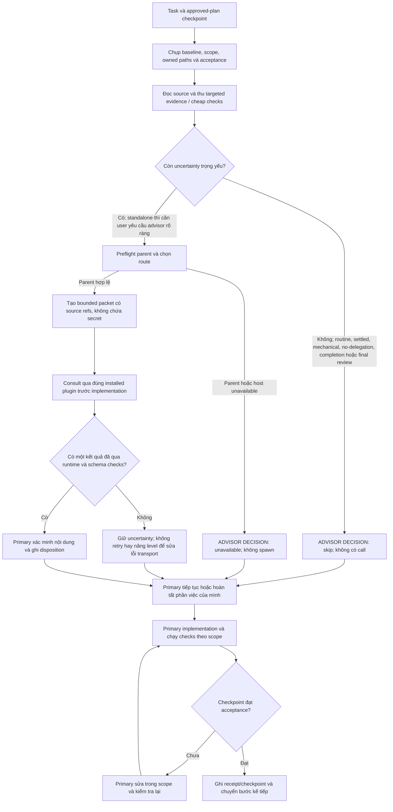
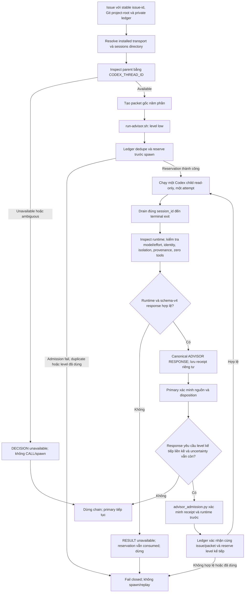
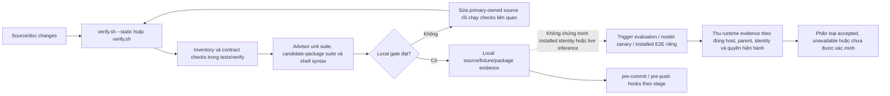
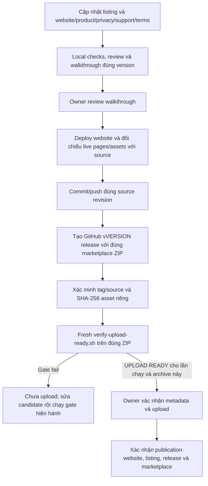

# Bản đồ workflow của local Codex-Advisor

Đối chiếu mã runtime tại commit `63e73afc07a2`; bản đồ cập nhật ngày 2026-10-27. Candidate `1.4.9-astra.3` có bằng chứng private CLI và Desktop trong phạm vi ghi nhận tại [trạng thái tích hợp](../MERGE-INTEGRATION-PLAN-CONSOLIDATED.md). Sơ đồ mô tả source; tự nó không thay thế bằng chứng cài đặt, runtime hoặc phát hành.

Mã runtime tại mốc này dùng Astra low-first ladder. Trước khi kết luận về bản public hoặc một ZIP phát hành, hãy đối chiếu source revision của đúng bản đó. Trạng thái private không xác nhận một đợt public release.

## Ý đồ và trạng thái migration

| Ý nghĩa của `advisor-execution` | Trạng thái trong checkout local |
|---|---|
| Policy sở hữu checkpoint, admission và escalation được dùng trong consultation | Có: policy Astra low-first nằm trong `plugins/advisor/skills/consultation/SKILL.md` và operations reference |
| Skill project-local `skills/advisor-execution/SKILL.md` hoặc `.agents/skills/advisor-execution/` | Không thấy trong cây repo |
| Skill độc lập thứ hai trong plugin Advisor | Chưa có: manifest trỏ tới `./skills/`; verifier đếm đúng một `SKILL.md` |
| Plan migration riêng | `docs/advisor-execution-migration-plans.md` vẫn ghi `draft brainstorm`, chưa có plan được duyệt |

Vì vậy, các sơ đồ dưới đây mô tả **consultation hiện được đóng gói**, không tuyên bố migration sang capability độc lập đã hoàn tất. Việc policy nằm trong plugin và việc workspace muốn route qua một skill riêng là hai lớp cần giữ tách biệt khi đọc sơ đồ. [Skill consultation](../plugins/advisor/skills/consultation/SKILL.md), [plugin manifest](../plugins/advisor/.codex-plugin/plugin.json), [static verifier](../plugins/advisor/scripts/verify.sh), [migration brainstorm](advisor-execution-migration-plans.md).

## 1. Plan/checkpoint và quyền sở hữu công việc

Primary giữ quyền sở hữu kế hoạch, implementation, checks, review và acceptance. Advisor chỉ trả lời câu hỏi bounded trước implementation; nó không thay primary hoặc cấp quyền cho bước sau.

Policy chỉ cho một bounded chain trước khi implementation bắt đầu. Tài liệu hóa, việc cơ học, câu hỏi đã giải quyết, completion/final review và yêu cầu no-delegation không mở route mới. Parent không khả dụng thì consultation dừng ở boundary đó; primary vẫn sở hữu công việc độc lập. [Consultation skill](../plugins/advisor/skills/consultation/SKILL.md), [checkpoint/resume plan](../Advisor_New_Plan.md).

## 2. Consultation runtime và Astra ladder

Các tên `Standard`, `Specialist` và các role alias là entrypoint; chúng không phải budget level. Mỗi issue bắt đầu ở `low`, dùng `gpt-6-astra`. Chỉ primary mới quyết định có cho phép escalation sau khi xem response và bằng chứng local.

Ladder logic là `low → medium → high → extra_high`; runtime effort tương ứng `low → medium → high → xhigh`. `extra_high` là level cuối, không phải level thứ năm. Mỗi lệnh chỉ có một child và một attempt; response lỗi, timeout/cancel, sai runtime, sai schema hoặc mất bằng chứng đều terminal, không retry, fallback hay dùng level cao hơn để cứu lượt lỗi. Deferred `session_id` là tiến độ: caller phải drain chính session đó trước khi phân loại envelope.

Escalation cần response trước đó đã được chấp nhận, yêu cầu đúng level liền kề cùng `reason`, `unresolved_difficulty`, `required_resolution`, và primary xác nhận uncertainty trọng yếu còn lại sau targeted evidence. Admission kiểm tra lại parent/child, response đã lưu, prompt/packet digest, model/effort, runtime/provenance và policy/transport revision. Ledger owner-private cung cấp reservation và chống replay qua session; crash, failure hoặc outcome không rõ vẫn tiêu thụ level. Reconcile/transfer cần proof, không tự khởi chạy replacement. [Operations contract](../plugins/advisor/skills/consultation/references/operations.md), [launcher](../plugins/advisor/scripts/run-advisor.sh), [admission](../plugins/advisor/scripts/advisor_admission.py), [ledger](../plugins/advisor/scripts/advisor_ledger.py), [ledger store](../plugins/advisor/scripts/advisor_ledger_store.py).

Sandbox read-only cộng với yêu cầu zero-tool và kiểm tra runtime sau khi chạy là acceptance boundary. Đây là kiểm tra sau thực thi; nếu runtime ghi nhận tool call, reject không thể đảo ngược dữ liệu đã được xử lý. `advisor.toml` cố định model/ladder; đổi role/tier không cấp quota. Catalog và journal không quyết định admission; optional usage journal tắt mặc định. [README](../README.md#selection), [invariants](../INVARIANTS.md).

## 3. Source verification, fixtures và live evidence

`verify.sh --static` là gate source không chạy model; script vẫn chạy Advisor unit tests, candidate-package tests và shell syntax. `pre-commit` chạy Ruff, Vulture và file-size check. `pre-push` bổ sung file-size-all, repo tests, Advisor verify, upload-readiness tests và Playwright. `evaluate-triggers.sh`, model canary và installed E2E là các đường runtime riêng; static/fixture xanh không chứng minh plugin đã load đúng, parent eligible, ledger binding, model inference hay receipt được chấp nhận. [README Development](../README.md#development), [verifier](../plugins/advisor/scripts/verify.sh), [hook config](../.pre-commit-config.yaml), [trigger evaluator](../plugins/advisor/scripts/evaluate-triggers.sh), [runtime plan](advisor-runtime-escalation-verification-plan.md).

## 4. Luồng phát hành

ZIP từ `package-candidate.sh` chỉ là local candidate. `verify-upload-ready.sh` kiểm tra ZIP/listing/website; script không xác minh GitHub tag, source hay asset. Release chỉ hoàn tất khi owner xác nhận publication. Receipt cũ không thay thế gate mới cho đúng archive. [Release process](release-process.md), [packager](../public-release/package-candidate.sh), [upload gate](../public-release/verify-upload-ready.sh).

## Resume và rollback

- Chỉ resume từ `last-good` có `COMPLETE`; kiểm tra lại `git status`, `HEAD`, receipt hashes và code commit SHA.
- Nếu code commit đã có nhưng receipt thiếu, kiểm tra code, chạy phần check còn thiếu rồi ghi receipt; không lặp implementation.
- Receipt checkpoint ghi code commit, parent receipt hash, checks/exit codes, changed-files digest và `COMPLETE`; commit receipt riêng.
- Rollback bằng `git revert` theo dependency; giữ WIP và ledger consumed/uncertain markers. Reconcile không cấp lại level và không spawn replacement.

Nguồn: [checkpoint/resume và rollback](../Advisor_New_Plan.md), [ledger contract](stage-b-ledger-contract.md).

## Tóm tắt ý đồ

Sơ đồ giữ nguyên ý đồ ban đầu: primary thực hiện và chấp nhận công việc; consultation là một cổng bounded cho uncertainty trọng yếu, với Astra low-first và escalation có ledger. Trong checkout hiện tại policy được nhúng trong skill `consultation`; skill `advisor-execution` độc lập và kế hoạch migration chưa có. Vì thế không nên gọi riêng migration skill là hoàn tất chỉ vì runtime ladder và ledger đã được cập nhật.
